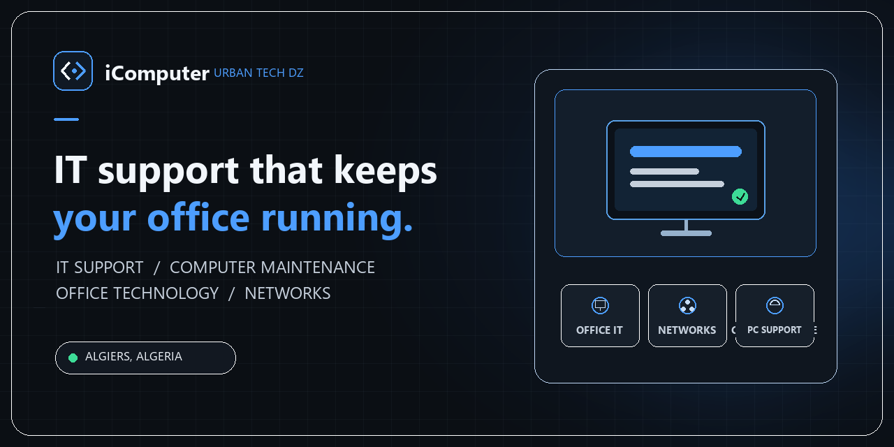

<div align="center">


# iComputer Urban Tech DZ

**Practical IT support and office technology for Algiers.**

[Visit the website](https://icomputer.netlify.app/) · [Browse services](https://icomputer.netlify.app/services.html) · [Request support](https://icomputer.netlify.app/booking.html)


</div>

<p align="center">
  
</p>

> **Website screenshot:** A page screenshot is not included yet. To capture one, open the [live homepage](https://icomputer.netlify.app/) at a 1440 × 900 desktop viewport, capture the full page, and save it as `images/website-preview.png`. Then add it here, for example: ``. The image above is the repository's branded social preview, not a screenshot.

## About

iComputer Urban Tech DZ is a local service website for computer support, maintenance, and office technology in Algiers, Algeria. It brings service information, practical computer guides, and contact options together in a responsive, multilingual interface.

The site is built as a collection of static HTML pages with hand-written CSS and browser JavaScript. It has no package installation or build step.

### Main features

- Service pages for office IT support, computer maintenance, Windows setup, Wi-Fi and office networks, printers, and file backup.
- Dedicated pages for accounting, law, notary, and design offices.
- A French-language page for formatting student dissertations and training documents.
- A knowledge section with client-side search and category filters.
- Arabic, French, and English interface translations on pages using the shared language controls.
- Dark and light themes, with the selected theme saved in the browser.
- Responsive layouts, mobile navigation, and reduced-motion support for selected effects.
- Booking and student-service forms that prepare WhatsApp messages in the browser.

See the [project overview](docs/PROJECT_OVERVIEW.md) for the page inventory and implementation details.

## Services

| Area | Examples |
| --- | --- |
| Office IT support | Software and Windows assistance for small offices |
| Computer maintenance | System checks, performance troubleshooting, and setup |
| Networks and devices | Wi-Fi, office networking, and printer setup |
| Files and backups | File organization and backup assistance |
| Office-specific support | Information for accounting, legal, notary, and design offices |
| Student documents | French-language document layout and formatting |
| Digital projects | Website and digital-project enquiries through the service pages |

Service availability and scope are described on the [website](https://icomputer.netlify.app/services.html).

## Languages and responsive design

The shared interface offers **Arabic, French, and English** language controls. Arabic is the default on most pages; the student-document service has a dedicated French page. Language switching is performed in client-side JavaScript, so it does not create separate translated URLs for every page.

Layouts use responsive CSS for desktop and mobile screens. Browser preferences for reduced motion are respected by selected animated features.

## Technology

- **HTML5** for page structure and metadata
- **CSS3** for layout, design tokens, themes, and responsive styling
- **Vanilla JavaScript** for translations, navigation, theme persistence, search, filtering, and page interactions
- **Netlify** for the production website, connected to the `main` branch

No frontend framework or package manager is required to run the site locally.

## Repository structure

```text
.
├── index.html                 # Homepage
├── services.html              # Service directory
├── booking.html               # Service enquiry
├── knowledge.html             # Searchable knowledge section
├── service-details.html       # Service information page
├── review.html                # Review page
├── thanks.html                # Form confirmation (noindex)
├── quran.html                 # Additional Arabic content page
├── services/                  # Service and audience-specific pages
├── css/                       # Shared, page-specific, and responsive styles
├── js/                        # Navigation, language, theme, search, and interactions
├── images/                    # Brand, hero, and service assets
├── docs/                      # Project, SEO, deployment, and profile documentation
├── robots.txt                 # Crawler directives and sitemap location
├── sitemap.xml                # Public page sitemap
└── _redirects                 # Netlify redirect rules
```

## Run locally

1. Clone the repository and enter its folder:

   ```sh
   git clone https://github.com/moohii/iComputer.git
   cd iComputer
   ```

2. Start a local static web server with Python:

   ```sh
   python -m http.server 8000
   ```

3. Open [http://localhost:8000](http://localhost:8000).

Stop the server with `Ctrl+C`. No dependencies need to be installed.

## Deployment

The production workflow is **VS Code → GitHub `origin/main` → Netlify production**. Netlify is connected to this repository's `main` branch and publishes successful pushes automatically. GitHub Pages is a separate available URL and is not the primary production host.

```sh
git add <your-files>
git commit -m "Describe your change"
git push origin main
```

Production: [icomputer.netlify.app](https://icomputer.netlify.app/) · [Deployment guide](docs/DEPLOYMENT.md)

## SEO

- Page titles and descriptions, with canonical URLs on indexable pages.
- Open Graph metadata on key pages and structured data where relevant.
- `robots.txt` points crawlers to the XML sitemap and excludes the form confirmation page.
- `sitemap.xml` lists the intended public pages.
- The confirmation page and internal service-detail utility page are marked `noindex`.

The site does not declare `hreflang` alternatives: its shared language switch changes page text in JavaScript rather than navigating between distinct, equivalent localized URLs. See the [SEO guide](docs/SEO_GUIDE.md).

## Useful links

- [Production website](https://icomputer.netlify.app/)
- [Services](https://icomputer.netlify.app/services.html)
- [Knowledge section](https://icomputer.netlify.app/knowledge.html)
- [Request a service](https://icomputer.netlify.app/booking.html)
- [GitHub repository](https://github.com/moohii/iComputer)
- [GitHub Pages URL](https://moohii.github.io/iComputer/) (separate from Netlify production)
- [Project overview](docs/PROJECT_OVERVIEW.md)
- [SEO guide](docs/SEO_GUIDE.md)
- [Deployment guide](docs/DEPLOYMENT.md)
- [Profile README draft](docs/profile-README.md)

## Contact and social

Use the [service enquiry page](https://icomputer.netlify.app/booking.html) or connect through the project's public channels:

- [Facebook](https://www.facebook.com/iComputer.MH)
- [Instagram](https://www.instagram.com/icomputer.urban_tech_dz/)
- [TikTok](https://www.tiktok.com/@icomputer_dz)

## مقدمة بالعربية

الموقع الرسمي لـ **iComputer Urban Tech DZ** لخدمات الدعم التقني وصيانة الحواسيب وحلول المكاتب في الجزائر العاصمة. يضم صفحات الخدمات ودليلاً تقنياً ووسائل للتواصل وطلب الخدمة.

## Présentation en français

Le site officiel d’**iComputer Urban Tech DZ** présente des services d’assistance informatique, de maintenance et de solutions bureautiques à Alger. Il propose également des guides pratiques et des moyens de demander un service.
